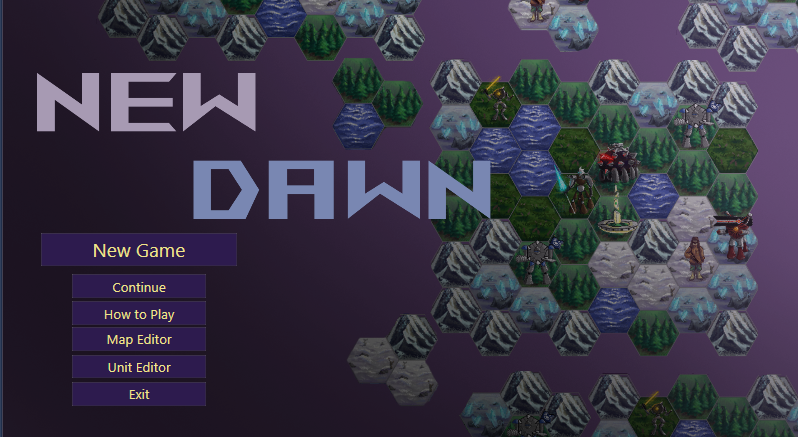
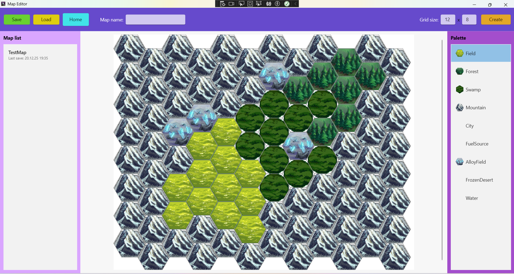
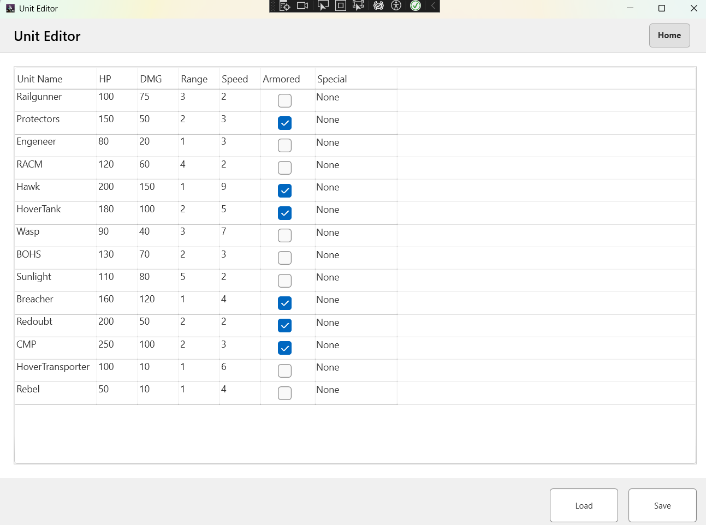
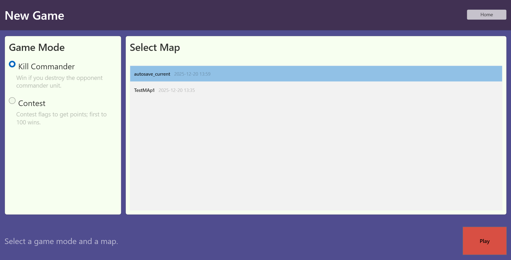
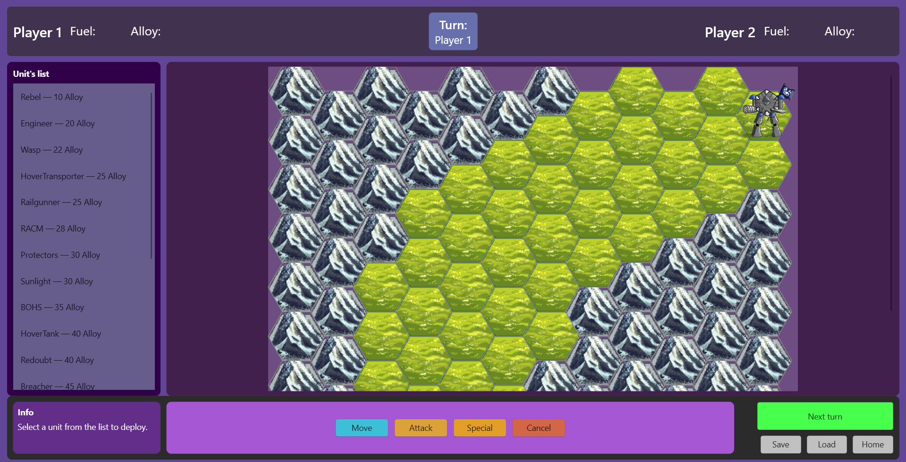
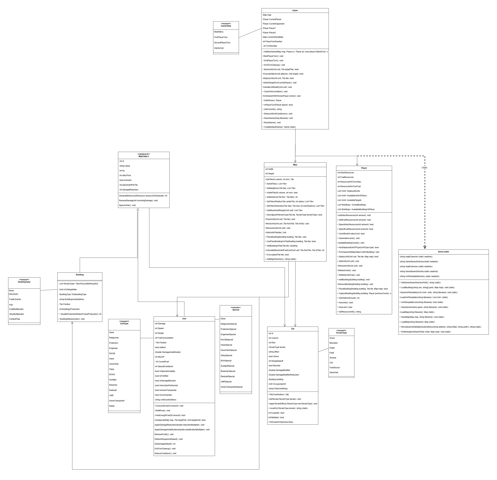

# Final Report: New Dawn

## Team Information

**Team Name:** The Domain Experts

**Team Members:**
- Matthew Buzzetti - Student ID: 2363090
- Artem Sova - Student ID: 2272422

---

## Project Description

**New Dawn** is a turn-based strategy game built using C# and WPF. The game features hex-grid tactical combat where two players compete to destroy each other's Commander Mech Platform (CMP) while managing resources and deploying various unit types.

### Core Features

**Gameplay Mechanics:**
- Turn-based hex-grid combat system with 14 unique unit types
- Resource management system (Alloy and Fuel)
- Special abilities for each unit type with cooldown mechanics
- Terrain effects that influence combat and movement
- 2 Different Gamemodes => Commander (Destroy Enemy Commander) and Contest (Win by Points)

**Unit System:**
- 14 distinct unit types: Rebel, Railgunner, Protectors, Engineer, RACM, Hawk, HoverTank, Wasp, BOHS, Sunlight, Breacher, Redoubt, CMP, and HoverTransporter
- Each unit has unique stats: HP, damage, range, speed, and fuel consumption
- Special abilities include shields, teleportation, fortification, and area-of-effect attacks
- Unit cores provide passive bonuses

**Map and Terrain:**
- 10 terrain types: Field, Forest, Swamp, Mountain, City, FuelSource, AlloyField, FrozenDesert and  Water
- Terrain affects movement speed, defense, and attack damage
- Hexagonal grid-based movement and combat range
- Custom map creation through Map Editor

**Building System:**
- Economic buildings: Alloy Quarry, Fuel Extractor
- Multiplicator buildings for resource amplification
- Strategic buildings: Hub (deployment zones)
- Buildings can be placed on specific terrain types

**Tools and Editors:**
- **Map Editor:** Create and save custom maps with terrain painting
- **Unit Editor:** Customize unit statistics and save unit templates

**Save/Load System:**
- Map persistence (`.map` files)
- Unit template persistence (`.csv` files)
- Game state saving and loading (`.sagm` files)
- Save functionality so that games can be saved and continued later

----------------------------------------------------------------------

## Development Approach

### 1. Understanding the Problem

We identified the need to create a strategic turn-based game that combines:
- **Tactical Depth:** Players must make meaningful decisions about unit deployment, movement, and combat
- **Resource Management:** Economic gameplay through building placement and resource generation
- **Accessibility:** Clear UI/UX with visual feedback for valid actions
- **Replayability:** Custom maps and unit configurations to vary gameplay

**Key Challenges Identified:**
- Implementing hex-grid pathfinding and distance calculation
- Balancing 14 different unit types with unique abilities
- Creating an intuitive UI for complex game state
- Managing turn-based state transitions
- Persisting game data across sessions

### 2. Formulating the Problem

We broke down the project into core systems:

**Data Layer:**
- Map representation (hex grid, terrain, tiles)
- Unit properties (stats, position, state)
- Player state (resources, owned units/buildings)
- Game state (current turn, win conditions)

**Logic Layer:**
- Movement and pathfinding algorithms
- Combat resolution and damage calculation
- Special ability execution
- Resource generation and spending
- Turn management and win condition checking

**Presentation Layer:**
- Hex rendering on WPF Canvas
- Visual highlighting for valid actions
- UI panels for unit shop, stats, and controls
- Map and Unit editors for content creation

**Persistence Layer:**
- File I/O for maps, units, and game saves
- CSV parsing for unit templates
- Custom save format for game state

### 3. Developing the Application

**Architecture Design:**
- Object-oriented design with inheritance (MapObject → Unit/Building)
- Separation of concerns (Game logic vs. UI rendering)
- Static utility classes for rendering and save/load operations

**Class Structure:**
- **Core Classes:** Tile, Map, Unit, Building, Player, Game
- **UI Classes:** MainWindow, MainGameWindow, MapEditorWindow, UnitEditorWindow, NewGameSetup
- **Utility Classes:** SaveAndLoaderHandler

**Algorithm Design:**
- **Hex Distance:** Axial coordinate system for accurate hex distance
- **Pathfinding:**Search for movement range calculation
- **Combat Resolution:** Damage multipliers based on terrain and unit buffs
- **Income/Ressource Generation:** Turn-based income with building multiplicators

**Data Structures:**
- Dictionnary for fast tile lookup by cordinates
- Lists to tracking units, buildings, and valid tiles ()
- Enums for terrain types, unit types, and special abilities

### 4. Implementing the Application

**Phase 1: Core Foundation**
- Implemented Tile, Map, and hex rendering system
- Created MapObject base class with HP, armor, and damage reduction
- Built Map Editor for testing terrain and visualization

**Phase 2: Unit System**
- Developed Unit class with 14 unit types and special abilities
- Implemented movement, fuel consumption, and combat
- Created Unit Editor for customizing unit templates

**Phase 3: Game Logic**
- Implemented Player class with resource management
- Built Game class with turn management and win conditions
- Added deployment, movement, and attack actions

**Phase 4: Special Abilities**
- Implemented 13 unique special abilities with cooldowns
- Added visual highlighting for special ability targets
- Created targeting system for different ability types

**Phase 5: Buildings (Planned)**
- Designed building placement and resource generation
- Planned capturable building mechanics
- Economic multiplicator system

**Phase 6: Polish and Persistence**
- Implemented save/load for maps, units, and games
- Added visual feedback (tile highlighting, tooltips)
- Created game setup flow and main menu

**Technical Decisions:**
- Used WPF Canvas for flexible hex rendering
- StreamGeometry for efficient hex shape reuse
- ImageBrush for terrain textures
- Base64 encoding for string data in save files

### 5. Testing

**Unit Testing Approach:**
- Tested individual methods (distance calculation, movement range, combat)
- Verified terrain effects apply correctly
- Validated save/load round-trip (data integrity)

**Integration Testing:**
- Tested full turn flow (deploy → move → attack → end turn)
- Verified player resource generation and spending
- Tested special abilities with different unit types
- Validated map editor → game workflow

**User Testing:**
- Playtested game balance (unit costs, damage values)
- Identified UI clarity issues (added tooltips, info bar)
- Fixed edge cases (invalid moves, zero fuel, death handling)

**Bug Fixes:**
- Fixed infinite recursion in SaveUnits method
- Corrected unit name disappearing in CSV loading (MapObject constructor)
- Fixed backing field vs. property usage issues
- Resolved file path conflicts (System.IO.Path vs. System.Windows.Shapes.Path)

**Known Limitations:**
- Building system not fully implemented
- Special abilities for some units are placeholders
- Mine placement system needs Mine class
- AI opponent not implemented (PvP only)

---

## OOP Design

### Class Overview

**Core Game Classes:**

1. **MapObject (Abstract Base Class)**
   - **Purpose:** Base class for all objects that can be placed on the map
   - **Properties:** Name, HP, MaxHP, Armored, PriceAlloy, DamageReduction, UnitsPerTile
   - **Methods:** ReceiveDamage(), GenerateResource(), SpawnUnits()
   - **Inheritance:** Unit and Building inherit from MapObject

2. **Unit (Inherits MapObject)**
   - **Purpose:** Represents combat units with movement, attack, and special abilities
   - **Properties:** Speed, Range, Damage, FuelConsumption, Position, CurrentFuel, MaxFuel, SpecialCooldown, ThisUnitType, ThisUnitSpecial
   - **Methods:** ConsumeFuel(), RefillFuel(), UseSpecial(), ApplyDamageAmplification(), ApplyDamageReduction(), RemoveFortify()
   - **Enums:** UnitType (14 types), UnitSpecial (13 abilities), Core (5 types)

3. **Building (Inherits MapObject)**
   - **Purpose:** Represents economic and strategic structures
   - **Properties:** ThisBuildingType, BuildingProduction, TilesThisCanBePlacedOn, Position
   - **Methods:** PlaceBuilding(), GenerateResources()
   - **Enums:** BuildingType (AlloyQuarry, FuelExtractor, AlloyMultiplicator, etc.)

4. **Tile**
   - **Purpose:** Represents a single hex tile on the map
   - **Properties:** TileTerrainType, Column, Row, Blocked, DamageModifier, DamageReductionModifier, OccupyingUnit, Building
   - **Methods:** IsOccupied(), IsWalkable(), SetTerrain(), ApplyTerrainEffects(), ToScreenPosition()
   - **Enums:** TerrainType (10 types)

5. **Map**
   - **What does it do?:** Manages the hex grid and all tiles
   - **Properties:** Width, Height, tiles (Dictionary), allUnits (List), allBuildings (List)
   - **Methods:** GetTile(), GetNeighbors(), GetDistance(), GetMovementRange(), GetTilesInRadius(), PlaceUnit(), MoveUnit(), RemoveUnit(), PlaceBuilding()

6. **Player**
   - **What does it do?:** Manages player resources, units, and buildings
   - **Properties:** AlloyResources, FuelResources, ResourcesPerTurnAlloy, ResourcesPerTurnFuel, DeployedUnits, AvailableUnitsToPlace, OwnedBuildings, AvailableTargets
   - **Methods:** GenerateIncome(), SpendAlloyResources(), DeployUnit(), PurchaseUnit(), RefreshUnits(), RefillAllUnitsFuel(), PlaceBuilding(), CaptureBuilding()

7. **Game**
   - **What does it do?:** Central game logic controller, manages turns and game state
   - **Properties:** CurrentPlayer, CurrentOpponent, Player1, Player2, CurrentGameMap, CurrentGameState, TurnNumber
   - **Methods:** InitializeGame(), StartPlayerTurn(), EndPlayerTurn(), MoveUnit(), ExecuteAttack(), DeployUnit(), CheckWinCondition(), SaveGame(), LoadGame()
   - **Enums:** GameState (Setup, Playing, GameOver), InteractionMode (None, Deploy, Move, Attack, Special)

8. **SaveAndLoaderHandler (Static Utility Class)**
   - **Purpose:** Handles all file I/O operations
   - **Methods:** SaveMap(), LoadMap(), SaveGame(), LoadGame(), SaveUnitTemplates(), LoadUnitTemplates(), NormalizeAndValidateAssetAddress()

**UI Classes:**

9. **MainWindow**
   - **Purpose:** Main menu with navigation to editors and game
   - **Methods:** BtnNewGame_Clicked(), BtnMapEditor_Clicked(), BtnUnitEditor_Clicked()

10. **MainGameWindow**
    - **Purpose:** Main game interface with hex grid, shop, and controls
    - **Fields:** _game, _mode, _selectedMapUnit, _selectedTile, _deployTiles, _moveTiles, _attackTiles, _specialTargetTiles
    - **Methods:** RenderGameMap(), GameHex_LeftClick(), BtnMove_Click(), BtnAttack_Click(), BtnSpecial_Click(), BtnEndTurn_Click(), HandleDeployClick(), CreateUnitFromType()

11. **MapEditorWindow**
    - **Purpose:** Create and edit custom maps
    - **Fields:** _currentMap, _selectedTerrain, _isPainting
    - **Methods:** CreateNewMapFromUI(), BtnSave_Click(), RenderMap(), RenderMapWithUnits(), Hex_LeftClick(), Hex_RightClick()

12. **UnitEditorWindow**
    - **Purpose:** Edit unit stats and save templates
    - **Fields:** _units (ObservableCollection of UnitRow)
    - **Methods:** BtnSave_Click(), BtnLoad_Click(), SaveUnitsToFile(), LoadUnitsFromFile()

13. **NewGameSetup**
    - **Purpose:** Configure game settings before starting (Mainly chooseing gamemode and map)
    - **Methods:** BtnStart_Click(), LoadMapList(), SelectMap()

### Class Relationships

**Inheritance:**
- MapObject ← Unit
- MapObject ← Building
- Window ← MainWindow, MainGameWindow, MapEditorWindow, UnitEditorWindow, NewGameSetup

**Composition:**
- Game HAS-A Map, Player1, Player2
- Map HAS-MANY Tiles
- Player HAS-MANY Units (DeployedUnits, AvailableUnitsToPlace)
- Player HAS-MANY Buildings (OwnedBuildings)
- Tile HAS-A Unit/Building 

**Association:**
- Unit references Tile (Position)
- Building references Tile (Position)
- Game references CurrentPlayer and CurrentOpponent (both Player objects)

**Utility:**
- SaveAndLoaderHandler provides static methods used by multiple classes

-------------------------------------------------------------------

## Contributions

### Work Division

**Matthew:**
- Core game architecture (MapObject, Unit, and Map classes)
- Movement and pathfinding algorithms in Map Class
- Combat system implementation
- Special abilities system
- Save/load system for maps
- Unit template loading system
- Turn management and game state
- Visual highlighting for actions
- Minor aid in Hex-grid rendering system
- Bug fixes and refactoring

**Artem:**
- Core game architecture (MapObject, Unit, and Tile classes)
- All of Hex-grid rendering system
- MainGameWindow (Mostly done by Artem except for minor help in backend)
- Combat system implementation
- Map Editor implementation
- Testing and bug 
- Documentation
- Asset creation


### Collaboration

- Both team members participated in design discussions and architecture decisions
- Code reviews were performed to maintain code quality
- Git was used for version control with feature branches
- Regular meetings to synchronize progress and resolve blockers

----------------------------------------------------------------------------------

## App Setup


Take screenshots (Windows: Win+Shift+S)
Save to screenshots/ folder next to your .md file
Use this format:
markdown
   
   *Caption text here*
Example:

markdown
### Main Menu

*The main menu shows New Game, Map Editor, and Unit Editor options.*
That's it! Most Markdown viewers (GitHub, VS Code, Typora) will render images automatically. ✅


You've used 75% of your weekly limit
Get more usage


Claude is AI and can make mistakes. Please double-check responses.


Final report · MD
Copy

# Final Report: New Dawn

## Team Information

**Team Name:** 

**Team Members:**
- Matthew [Last Name] - Student ID: [ID Number]
- [Partner Name] - Student ID: [ID Number]

---

## Project Description

**New Dawn** is a turn-based strategy game built using C# and WPF. The game features hex-grid tactical combat where two players compete to destroy each other's Commander Mech Platform (CMP) while managing resources and deploying various unit types.

### Core Features

**Gameplay Mechanics:**
- Turn-based hex-grid combat system with 14 unique unit types
- Resource management system (Alloy and Fuel)
- Special abilities for each unit type with cooldown mechanics
- Terrain effects that influence combat and movement
- Commander units (CMP) as win condition objectives

**Unit System:**
- 14 distinct unit types: Rebel, Railgunner, Protectors, Engineer, RACM, Hawk, HoverTank, Wasp, BOHS, Sunlight, Breacher, Redoubt, CMP, and HoverTransporter
- Each unit has unique stats: HP, damage, range, speed, and fuel consumption
- Special abilities include shields, teleportation, fortification, and area-of-effect attacks
- Unit cores provide passive bonuses

**Map and Terrain:**
- 10 terrain types: Field, Forest, Swamp, Mountain, City, FuelSource, AlloyField, FrozenDesert, Water
- Terrain affects movement speed, defense, and attack damage
- Hexagonal grid-based movement and combat range
- Custom map creation through Map Editor

**Building System:**
- Economic buildings: Alloy Quarry, Fuel Extractor
- Multiplicator buildings for resource amplification
- Strategic buildings: Hub (deployment zones)
- Buildings can be placed on specific terrain types

**Tools and Editors:**
- **Map Editor:** Create and save custom maps with terrain painting
- **Unit Editor:** Customize unit statistics and save unit templates
- **Game Setup:** Configure player names and select maps before starting

**Save/Load System:**
- Map persistence (`.map` files)
- Unit template persistence (`.csv` files)
- Game state saving and loading (`.sagm` files)
- Auto-save functionality

---

## Development Approach

### 1. Understanding the Problem

We identified the need to create a strategic turn-based game that combines:
- **Tactical Depth:** Players must make meaningful decisions about unit deployment, movement, and combat
- **Resource Management:** Economic gameplay through building placement and resource generation
- **Accessibility:** Clear UI/UX with visual feedback for valid actions
- **Replayability:** Custom maps and unit configurations to vary gameplay

**Key Challenges Identified:**
- Implementing hex-grid pathfinding and distance calculation
- Balancing 14 different unit types with unique abilities
- Creating an intuitive UI for complex game state
- Managing turn-based state progression
- Persisting game data across sessions

### 2. Formulating the Problem

We broke down the project into core systems:

**Data Layer:**
- Map representation (hex grid, terrain, tiles)
- Unit properties (stats, position, state)
- Player state (resources, owned units/buildings)
- Game state (current turn, win conditions)

**Logic Layer:**
- Movement and pathfinding algorithms
- Combat resolution and damage calculation
- Special ability execution
- Resource generation and spending
- Turn management and win condition checking

**Presentation Layer:**
- Hex rendering on WPF Canvas
- Visual highlighting for valid actions
- UI panels for unit shop, stats, and controls
- Map and Unit editors for content creation

**Persistence Layer:**
- File I/O for maps, units, and game saves
- CSV parsing for unit templates
- Custom save format for game state

### 3. Developing the Application

**Architecture Design:**
- Object-oriented design with inheritance (MapObject → Unit/Building)
- Separation of concerns (Game logic vs. UI rendering)
- Static utility classes for rendering and save/load operations

**Class Structure:**
- **Core Classes:** Tile, Map, Unit, Building, Player, Game
- **UI Classes:** MainWindow, MainGameWindow, MapEditorWindow, UnitEditorWindow, NewGameSetup
- **Utility Classes:** SaveAndLoaderHandler

**Algorithm Design:**
- **Hex Distance:** Axial coordinate system for accurate hex distance
- **Pathfinding:** Breadth-first search for movement range calculation
- **Combat Resolution:** Damage multipliers based on terrain and unit buffs
- **Resource Generation:** Turn-based income with building multiplicators

**Data Structures:**
- Dictionary for fast tile lookup by coordinates
- Lists for tracking units, buildings, and valid action tiles
- Enums for terrain types, unit types, and special abilities

### 4. Implementing the Application

**Phase 1: Core Foundation**
- Implemented Tile, Map, and hex rendering system
- Created MapObject base class with HP, armor, and damage reduction
- Built Map Editor for testing terrain and visualization

**Phase 2: Unit System**
- Developed Unit class with 14 unit types and special abilities
- Implemented movement, fuel consumption, and combat
- Created Unit Editor for customizing unit templates

**Phase 3: Game Logic**
- Implemented Player class with resource management
- Built Game class with turn management and win conditions
- Added deployment, movement, and attack actions

**Phase 4: Special Abilities**
- Implemented 13 unique special abilities with cooldowns
- Added visual highlighting for special ability targets
- Created targeting system for different ability types

**Phase 5: Buildings (Planned)**
- Designed building placement and resource generation
- Planned capturable building mechanics
- Economic multiplicator system

**Phase 6: Polish and Persistence**
- Implemented save/load for maps, units, and games
- Added visual feedback (tile highlighting, tooltips)
- Created game setup flow and main menu

**Technical Decisions:**
- Used WPF Canvas for flexible hex rendering
- StreamGeometry for efficient hex shape reuse
- ImageBrush for terrain textures
- Base64 encoding for string data in save files

### 5. Testing

**Unit Testing Approach:**
- Tested individual methods (distance calculation, movement range, combat)
- Verified terrain effects apply correctly
- Validated save/load round-trip (data integrity)

**Integration Testing:**
- Tested full turn flow (deploy → move → attack → end turn)
- Verified player resource generation and spending
- Tested special abilities with different unit types
- Validated map editor → game workflow

**User Testing:**
- Playtested game balance (unit costs, damage values)
- Identified UI clarity issues (added tooltips, info bar)
- Fixed edge cases (invalid moves, zero fuel, death handling)

**Bug Fixes:**
- Fixed infinite recursion in SaveUnits method
- Corrected unit name disappearing in CSV loading (MapObject constructor)
- Fixed backing field vs. property usage issues
- Resolved file path conflicts (System.IO.Path vs. System.Windows.Shapes.Path)

**Known Limitations:**
- Special abilities for some units are placeholders (Did not have time to implement them)
- Mine placement system needs Mine class
- AI opponent not implemented (PvP only)

---

## OOP Design

### Class Overview

**Core Game Classes:**

1. **MapObject (Abstract Base Class)**
   - **Purpose:** Base class for all objects that can be placed on the map
   - **Properties:** Name, HP, MaxHP, Armored, PriceAlloy, DamageReduction, UnitsPerTile
   - **Methods:** ReceiveDamage(), GenerateResource(), SpawnUnits()
   - **Inheritance:** Unit and Building inherit from MapObject

2. **Unit (Inherits MapObject)**
   - **Purpose:** Represents combat units with movement, attack, and special abilities
   - **Properties:** Speed, Range, Damage, FuelConsumption, Position, CurrentFuel, MaxFuel, SpecialCooldown, ThisUnitType, ThisUnitSpecial
   - **Methods:** ConsumeFuel(), RefillFuel(), UseSpecial(), ApplyDamageAmplification(), ApplyDamageReduction(), RemoveFortify()
   - **Enums:** UnitType (14 types), UnitSpecial (13 abilities), Core (5 types)

3. **Building (Inherits MapObject)**
   - **Purpose:** Represents economic and strategic structures
   - **Properties:** ThisBuildingType, BuildingProduction, TilesThisCanBePlacedOn, Position
   - **Methods:** PlaceBuilding(), GenerateResources()
   - **Enums:** BuildingType (AlloyQuarry, FuelExtractor, AlloyMultiplicator, etc.)

4. **Tile**
   - **Purpose:** Represents a single hex tile on the map
   - **Properties:** TileTerrainType, Column, Row, Blocked, DamageModifier, DamageReductionModifier, OccupyingUnit, Building
   - **Methods:** IsOccupied(), IsWalkable(), SetTerrain(), ApplyTerrainEffects(), ToScreenPosition()
   - **Enums:** TerrainType (10 types)

5. **Map**
   - **Purpose:** Manages the hex grid and all tiles
   - **Properties:** Width, Height, tiles (Dictionary), allUnits (List), allBuildings (List)
   - **Methods:** GetTile(), GetNeighbors(), GetDistance(), GetMovementRange(), GetTilesInRadius(), PlaceUnit(), MoveUnit(), RemoveUnit(), PlaceBuilding()

6. **Player**
   - **Purpose:** Manages player resources, units, and buildings
   - **Properties:** AlloyResources, FuelResources, ResourcesPerTurnAlloy, ResourcesPerTurnFuel, DeployedUnits, AvailableUnitsToPlace, OwnedBuildings, AvailableTargets
   - **Methods:** GenerateIncome(), SpendAlloyResources(), DeployUnit(), PurchaseUnit(), RefreshUnits(), RefillAllUnitsFuel(), PlaceBuilding(), CaptureBuilding()

7. **Game**
   - **Purpose:** Central game logic controller, manages turns and game state
   - **Properties:** CurrentPlayer, CurrentOpponent, Player1, Player2, CurrentGameMap, CurrentGameState, TurnNumber
   - **Methods:** InitializeGame(), StartPlayerTurn(), EndPlayerTurn(), MoveUnit(), ExecuteAttack(), DeployUnit(), CheckWinCondition(), SaveGame(), LoadGame()
   - **Enums:** GameState (Setup, Playing, GameOver), InteractionMode (None, Deploy, Move, Attack, Special)

8. **SaveAndLoaderHandler (Static Utility Class)**
   - **Purpose:** Handles all file I/O operations
   - **Methods:** SaveMap(), LoadMap(), SaveGame(), LoadGame(), SaveUnitTemplates(), LoadUnitTemplates(), NormalizeAndValidateAssetAddress()

**UI Classes:**

9. **MainWindow**
   - **Purpose:** Main menu with navigation to editors and game
   - **Methods:** BtnNewGame_Clicked(), BtnMapEditor_Clicked(), BtnUnitEditor_Clicked()

10. **MainGameWindow**
    - **Purpose:** Main game interface with hex grid, shop, and controls
    - **Fields:** _game, _mode, _selectedMapUnit, _selectedTile, _deployTiles, _moveTiles, _attackTiles, _specialTargetTiles
    - **Methods:** RenderGameMap(), GameHex_LeftClick(), BtnMove_Click(), BtnAttack_Click(), BtnSpecial_Click(), BtnEndTurn_Click(), HandleDeployClick(), CreateUnitFromType()

11. **MapEditorWindow**
    - **Purpose:** Create and edit custom maps
    - **Fields:** _currentMap, _selectedTerrain, _isPainting
    - **Methods:** CreateNewMapFromUI(), BtnSave_Click(), RenderMap(), RenderMapWithUnits(), Hex_LeftClick(), Hex_RightClick()

12. **UnitEditorWindow**
    - **Purpose:** Edit unit statistics and save templates
    - **Fields:** _units (ObservableCollection of UnitRow)
    - **Methods:** BtnSave_Click(), BtnLoad_Click(), SaveUnitsToFile(), LoadUnitsFromFile()

13. **NewGameSetup**
    - **Purpose:** Configure game settings before starting
    - **Methods:** BtnStart_Click(), LoadMapList(), SelectMap()

### Class Relationships

**Inheritance:**
- MapObject ← Unit
- MapObject ← Building
- Window ← MainWindow, MainGameWindow, MapEditorWindow, UnitEditorWindow, NewGameSetup

**Composition:**
- Game HAS-A Map, Player1, Player2
- Map HAS-MANY Tiles
- Player HAS-MANY Units (DeployedUnits, AvailableUnitsToPlace)
- Player HAS-MANY Buildings (OwnedBuildings)
- Tile HAS-A Unit (optional), Building (optional)

**Association:**
- Unit references Tile (Position)
- Building references Tile (Position)
- Game references CurrentPlayer and CurrentOpponent (both Player objects)

**Utility:**
- SaveAndLoaderHandler provides static methods used by multiple classes

---

## Contributions

### Work Division

**Matthew:**
- Core game architecture (Game, Unit, Map classes)
- Movement and pathfinding algorithms
- Combat system implementation
- Special abilities system
- Map Editor implementation
- Minor parts of Save/load system for maps
- Unit template loading system
- Turn management and game state
- Some Visual highlighting for actions
- Player Class (Both worked on)
- Bug fixes and refactoring

**Artem:**
- Object Handling of Core Architecture (Tile, Unit, Map Objects)
- Hex-grid rendering system
- Full UI and Tile Arangement for game (With Minor help in backend)
- Player Class (Both worked on)
- Testing and bug reporting
- Documentation
- Asset creation (Created All Assets for game)
- Worked on Building Assesment and Handling
- Majority of Save and Loading states
- Made Unit and Save Templates 
- Some Visual highlighting for actions

---

## App Setup

### Prerequisites
- .NET 9.0 or later
- Windows 10/11 (WPF requirement)
- Visual Studio Community 2022

### Installation Steps

1. **Clone/Download Project**
   ```
   Extract NewDawn project files to a directory
   ```

2. **Open Solution**
   ```
   Open NewDawn.sln in Visual Studio
   ```

3. **Build Project**
   ```
   Build → Build Solution 
   ```

4. **Run Application**
   ```
   Press F5 or click Start
   ```

###  Info for Built-in Accounts

**Not applicable** - This is a local multiplayer game with no authentication really needed.

### Asset Requirements
**Tile Assets (Required):**
Place in `Assets/Tiles/`:
- tile_field.png
- tile_forest.png
- tile_swamp.png
- tile_mountain.png
- tile_alloyfield.png
- [Additional Sprites for tiles not included yet]

**Unit Assets (Optional):**
Place in `Assets/Units/`:
- unit_rebel.png, unit_hawk.png, unit_cmp.png, etc.

**Building Assets (Optional):**
Place in `Assets/Buildings/`:
- building_alloyquarry.png, building_hub.png, etc.

### Default Files

**DefaultUnits.csv:**
A default unit template file is loaded from `Saves/Unit/DefaultUnits.csv`. If not present in the players directory, default templates for units are used.

## App Snapshots

### Main Menu


### Map Editor

*Caption: Map Editor showing a variuable hex grid. Users can paint terrain by selecting from the palette on the left and clicking tiles. Mountains, swamps, and resource tiles are visible.*

### Unit Editor

*Caption: Unit Editor displaying all 14 unit types in a DataGrid. Each unit's stats (HP, Damage, Range, Speed, etc.) can be edited and saved to CSV.*

### New Game Setup

*Caption: Game setup screen where players enter their names and select a map to play on.*

### Main Game 

*Caption: Main game interface showing the unit shop on the left. Actions on the bottom, and*
*gameplay in the middle*

---------------------------------

## Future Work

### Planned Features


**Advanced Special Abilities:**
- Complete Mine placement system for Engineer
- Implement unit spawning for CMP special
- Add extra movement phase for Wasp ability
- Create visual effects for special ability activation

**AI Opponent (Maybe):**
- Implement basic AI for single-player mode
- AI decision-making for unit deployment
- AI pathfinding and target selection
- Difficulty levels (Easy, Medium, Hard)

**Enhanced UI/UX:**
- Animated unit movement along hex path
- Combat damage popups and visual effects
- Sound effects for actions (attack, deploy, special)
- Background music and ambient sounds
- Minimap for large maps
- Undo/Redo functionality

**Multiplayer (Unsure currently):**
- Network multiplayer support (TCP/IP)
- Turn timer for competitive play
- Spectator mode
- Replay system to review past games

**Balance and Polish:**
- Extensive playtesting for unit balance
- Adjust terrain effects based on player feedback
- Refine resource costs and generation rates
- Add more unit types and special abilities

**Performance Optimization:**
- Optimize rendering for larger maps (100+ tiles)
- Cache pathfinding results for better performance
- Reduce memory usage for long game sessions


### Technical Improvements

**Code Refactoring:**
- Extract rendering logic into separate Renderer classes
- Implement Command pattern for undo/redo
- Use Dependency Injection for better testability
- Add comprehensive unit tests

**Data-Driven Design:**
- Move all unit stats to external JSON/XML files
- Create mod support for custom units and abilities
- Allow custom terrain types via configuration

**Documentation:**
- Add XML documentation to all public methods
- Create developer guide for extending the game

------------------------------------------

## Appendix A: Team Contract


This is an informal contract to ensure that all team members have a common understanding of what is expected in terms of work standards, communication, division or work, and conflict resolution. 

**Team Members (Name & ID)**

|          | Name             | Student Id |
| -------- | -----------------| -----------|
| Member A | Matthew Buzzetti |  2363090   |
| Member B | Artem Sova       | 2272422    |


## Strength & Weaknesses 

Within the context of this project, what are the strengths and weaknesses that each member brings to the team? 

  

Member A: 
|                   | Strength                           | Weakness   |
| --------          | ---------------                    | -----------|
| Matthew Buzzetti  | Open-minded to ideas               | Bad at time management of tasks   |
|                   | Good understanding of OOP Concepts | Struggles with debugging |
|                   | Dilligent                          | Difficulty working in teams (In Microsoft Teams)  | 

Member B :

|          | Strength         | Weaknese                      |
| -------- | -----------------| ------------------------------|
| Artem Sova | Creative       | Slowly writes code            |
|            | Adaptable      | Not attentive                 |
|            |                | Bad at time management tasks  | 
|            |                | Over-engineering solutions      | 

  

## Definition of “good enough” for this project

**What would the team collectively consider “good enough” of an achievement for the project?**

The goal of the project would be to make a functional turn based strategy game; with randomly generated maps for PVP, with various (at least 6) terrain tiles which influence units; the game should have different units(at least 8 units). And one campaign mission.

## Picked Topic

Tile-based Turn-based Strategy Game (Sci-fi theme)


## Division of work 

How will each member contribute to the project? 

Member A: I will do 50% of the project, including code and designs 

Member B: I will do 50% of the project, including code and designs 

  

## Frequency of communication 

**How often will the team be in touch and what tools will be used to communicate?** 

We will meet in __Discord__ two times a week for 3 hours, and during the rest of the week we would meet for 30 minutes at the end of the day if we pushed important parts of code or have question.

**What is a reasonable delay to reply to messages? Is it the same for weekdays and weekends?**
Response delays - one day (24 hours) for weekdays and for wekends 32 hours
  

## Receiving feedback 

Each member must provide a sample sentence for how they would like to receive constructive feedback from their peers. 

(If unsure, assume a hypothetical situation such as you have not completed your work in time or you have not replied to a message in a timely manner). 

  

Member A: I would like to recieve constructive critique that acknoledges the ways in which I could possibly improve my code with additional ideas.

Member B: I would like to recieve constructive and honest critique and maybe ideas for improving my code.   

  

## In case of conflict 


If a team member fails to communicate as described in this contract or does not respond to constructive feedback, what measures should the other teammate take? 
  
I will try to talk with my peer about the situation and if conflict persists , I will talk my professor about the ways to resolve the conflict.

-------------------------------------------------------------------------------

## Appendix B: UML Class Diagram





**Note: `.drawio` file for UML Diagram is located within Documents Folder (Please refer to it as this is illegible)**